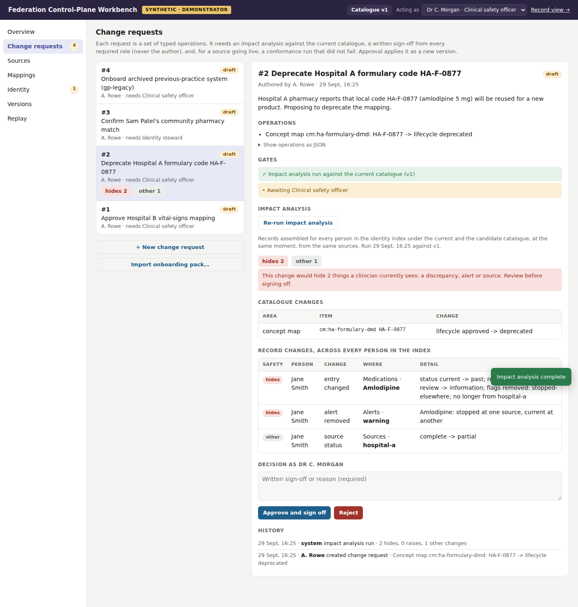
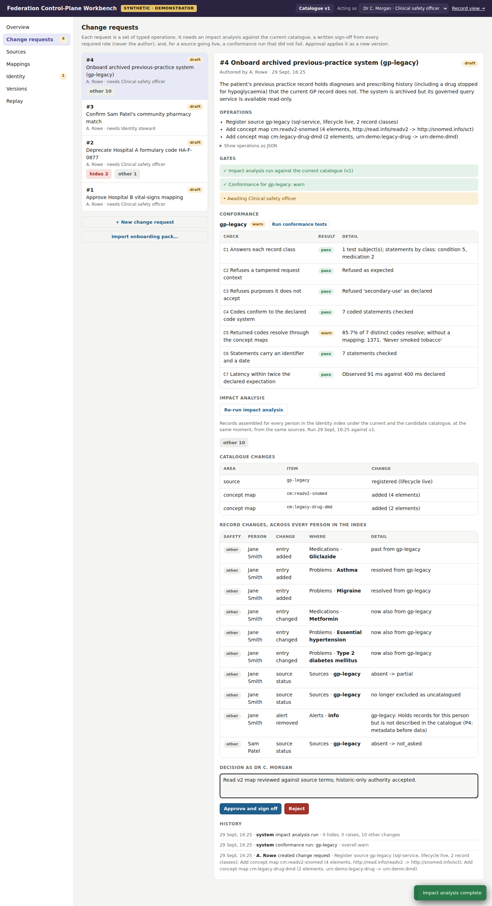
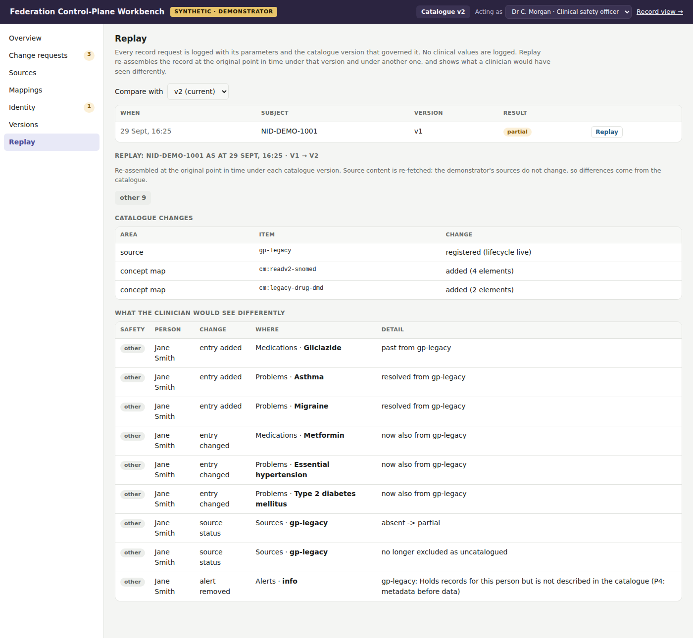

# Federation Control-Plane Workbench

The third demonstrator for the *Metadata-Mediated Federated Health Data Architecture*. The first showed a federated query and the second a federated patient record. This one shows **the part a sceptic asks about next: who maintains the catalogue, the mappings and the identity links, and what happens to patients' records when they change?**

The design calls the semantic control plane the intellectual centre of the architecture, and names mapping governance as its largest hidden cost. Here the control plane is treated as what the design says it must be: operational infrastructure, versioned, changed only under review, with every change assessed for its effect on real records before anyone signs it off.

> **Synthetic data only.** Every person, organisation, identifier, record and value is invented. SNOMED CT, ICD-10, Read v2 and LOINC codes are real codes used illustratively and must be verified before any real use. Medicine codes are placeholders for dm+d identifiers. Personas stand in for authenticated users. This is a demonstrator of architectural behaviour, not clinical software, and is not affiliated with any health service.



## What it shows

It has two views on one running system:

- **Record view** (`/`): the federated patient record from the second demonstrator. You can now assemble it under **any catalogue version**, and it states which version governed it.
- **Workbench** (`/workbench`): the steward's view. Switch persona (informatics analyst, clinical safety officer, identity steward) to see what each may do.

### The governance rules

These are enforced by the service, not the interface:

1. The live catalogue changes **only** by applying an approved **change request**: a set of typed, validated operations.
2. Every change request needs an **impact analysis** against the *current* catalogue before approval, and it must be re-run if the catalogue has moved on since.
3. Approval needs a **written sign-off** from every required role: the **clinical safety officer** for catalogue and terminology content, the **identity steward** for identity links. The approver can never be the author (**four eyes**).
4. A source cannot become live without a **conformance run** against the candidate catalogue that did not fail.
5. Every approved change creates a new, immutable **catalogue version**. Rolling back is itself a reviewed change, and it creates a new version.
6. Every action is a **governance event**. Every record request is logged with its catalogue version, and **no clinical values**, so it can be replayed.

### Four seeded change requests, each making one point

| # | Change request | What the workbench shows |
|---|---|---|
| 1 | **Approve Hospital B's vital-signs mapping** (currently *proposed*) | The simple case. Hospital B's ward observations appear in the record, and the section's coverage changes from *unmapped* to *contributed*. |
| 2 | **Deprecate Hospital A formulary code HA-F-0877** (the code is being reused) | The dangerous case. Impact analysis marks it as one that **hides** things: Jane Smith's amlodipine discrepancy (stopped by the GP, still on the renal clinic's list) disappears along with its alert. It looks like a housekeeping change, but it is a clinical-safety decision. |
| 3 | **Confirm Sam Patel's community pharmacy match** (0.72, below the direct-care threshold) | Better identity **raises** a safety flag. Once the pharmacy is queried, it shows Sam's preventer inhaler has not been dispensed. Needs the identity steward, not the clinical safety officer. |
| 4 | **Onboard the archived previous-practice system** (`gp-legacy`, Read v2 coded) | The full onboarding path. The system is refused under P4, then registered from an onboarding pack, conformance-tested, impact-assessed, signed off and made live. It needs no broker or adapter code, because it publishes the same governed view contract as the current GP. |

Onboarding is where the architecture's claims are tested:

- **Conformance is tested, not trusted.** The harness checks that the source answers every record class it claims. It also checks that it refuses a tampered request and a purpose it does not accept, that its codes look like the declared code system, that every code resolves through the candidate concept maps, that every record carries an identifier and a date, and that latency is within twice the declared figure.
- The legacy system passes with a **warning**: Read code `1371.` (never smoked) has no mapping. The source can go live, but the record says so: *1 record with no approved code mapping*. A follow-up change can add the mapping, and a re-test then passes.
- After onboarding, Jane's record gains her previous practice's history. It adds migraine and childhood asthma (both resolved), and gliclazide stopped for hypoglycaemia. T2DM and hypertension now carry four sources.
- Her old practice ended her metformin when she transferred out, and her new GP restarted it. That old stop is **superseded** by later prescribing, so it is *not* flagged as a discrepancy. The real metformin issue, the dose difference, is still flagged.



### Replay

Any logged record request can be re-assembled at its original point in time under the version that governed it, and compared with any other version. This turns "every result records the catalogue version that governed its plan" into something you can check.



## Quick start

Requires Python 3.10+.

```bash
python -m venv .venv
source .venv/bin/activate          # Windows: .venv\Scripts\activate
pip install -e ".[dev]"

fwb serve                          # record view http://127.0.0.1:8000/  ·  workbench http://127.0.0.1:8000/workbench
```

The control-plane store is a SQLite file at `.fwb/controlplane.db` (override with `FWB_STORE`). It is seeded on first start from `catalogue/*.json`, with the four demo change requests. To start again:

```bash
fwb reset
```

Other commands:

```bash
fwb demo                           # scripted walk-through of all four scenarios, in memory
fwb record                         # Jane Smith's record under the current catalogue
fwb record --version 1             # ...under version 1
pytest -q                          # 31 tests
```

With Docker:

```bash
docker build -t federation-workbench .
docker run -p 8000:8000 federation-workbench
```

OpenAPI documentation: `http://127.0.0.1:8000/docs`.

### A suggested walk-through

1. **Record view**: assemble Jane Smith's record. Note the `gp-legacy` source excluded as uncatalogued, and the amlodipine and metformin discrepancies. That request is now in the replay log.
2. **Workbench → Change requests → #2**, acting as the clinical safety officer: run the impact analysis. It *hides 2*. Reject it with a reason.
3. **#4**: try to approve (blocked: no impact analysis), then run impact (blocked again: no conformance run), then run conformance (*warn*: 1371. unmapped). Approve with a sign-off. The catalogue is now v2.
4. Switch to the **informatics analyst** and open #1. Approval is disabled, with the reason shown. Switch to the **identity steward** and approve #3 (run its impact first). Catalogue v3.
5. **Record view**: the catalogue selector now lists v1–v3. Compare Jane's record under v1 and v3.
6. **Replay**: replay the request from step 1 against the current version.
7. **Mappings**: propose adding a mapping for Read `1371.`, then assess and approve it. Under **Sources**, re-test `gp-legacy`: it now passes.

## How it is built

```
catalogue/              Seed content for version 1 (catalogue, terminology, identity index)
data/                   Synthetic source content, one file per source, including gp_legacy.json
onboarding/gp-legacy.json   Onboarding pack: source description and Read v2 / legacy drug concept maps
src/fwb/
  controlplane/
    store.py            SQLite: immutable versions (full snapshots), change requests,
                        governance events, record-request log (no clinical values)
    ops.py              Typed operations: set_exposure_mapping, set_concept_map_element,
                        add_concept_map, register_source, set_source_lifecycle,
                        identity_decision, restore_version; required roles
    workbench.py        Governance rules: impact before approval, four eyes, roles,
                        written sign-off, conformance gate, staleness, apply as new version
    conformance.py      Conformance harness (C1–C7) run through the broker's own adapters
    diff.py             Catalogue diff between versions; record diff classified as
                        hides / raises / other
  broker.py …           The record engine from the second demonstrator, with source
                        lifecycle, element-level mapping lifecycle, a generic governed-SQL
                        view contract, identity decisions, and the medication supersede rule
  sources/governed_sql.py   Reusable governed-SQL mock; gp and gp-legacy are two instances
  api.py, cli.py        HTTP API and command line
  static/index.html     Record view (with catalogue version selector)
  static/workbench.html Workbench
tests/                  Governance rules, the four scenarios, replay, API
docs/design-notes.md    Design decisions and the mapping to the architecture
```

### What is real and what is mocked

Real: versioned control-plane store; change operations and validation; the governance rules; impact analysis across the whole synthetic population; conformance harness; catalogue and record diffs; replay; the record engine itself.

Mocked: the source systems (as before, with the governed-SQL mock now reusable), authentication (personas), and the terminology server (a small fragment).

### Configuration

| Variable | Default | Purpose |
|---|---|---|
| `FWB_STORE` | `.fwb/controlplane.db` | Control-plane store; `:memory:` for a throwaway run |
| `FWB_IMAGING_DELAY` | `5` | Seconds the imaging mock takes to answer |
| `FWB_AUDIT_FILE` | unset | Append broker audit events as JSON lines |
| `FWB_ROOT` | repository root | Where `catalogue/`, `data/` and `onboarding/` are found |

## Limits

- Personas are selected, not authenticated. A real deployment would bind roles to identities and sign sign-offs.
- Impact analysis runs across the synthetic population (two people). At scale it would run over a representative sample or a materialised view, with the full population checked asynchronously.
- Replay re-fetches source content. In this demonstrator the sources do not change, so differences come from the catalogue. With live sources, replay would need source-side versioning or the preserved originals described in the design.
- Versions are full snapshots. That is simple and fine at this size, but a large catalogue would store deltas.
- Not yet implemented: materialised views registered as sources, scheduled re-testing, and change requests spanning multiple approval stages beyond one sign-off per role.

## Publishing to GitHub

```bash
cd federation-workbench
git init
git add .
git commit -m "Initial commit: federation control-plane workbench"
git branch -M main
git remote add origin https://github.com/<your-account>/federation-workbench.git
git push -u origin main
```

The GitHub Actions workflow runs lint, tests and the scripted demo on Python 3.10–3.12.

## Licence

MIT. See `LICENSE`.
